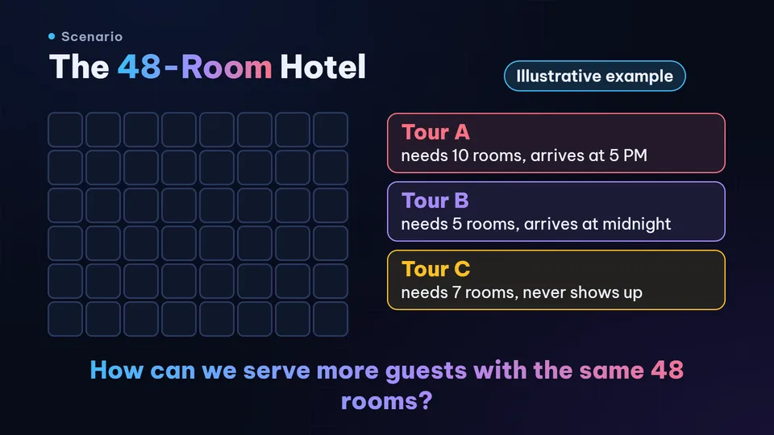

# S4 - Presentations

Slide decks for S4 presentations. Each topic has its content files in `content/<topic>/` and its decks in `slide/<topic>/<variant>/`, one deck per content file.

## Setup

Node.js 22+ and npm. Install the shared toolchain once, from the repository root:

```sh
npm install
```

All HyperFrames decks share the root `package.json`. Run every command below from the repository root.

## Decks

Every deck is online at **https://the-khiem7.github.io/vllm-highlevel-understanding/**. Open a deck, then click Present or press P inside it for the presenter view with notes; Audience reopens the audience screen, which follows the deck tab in the same browser only.

| vLLM - restaurant | vLLM - llmhotel48 |
|---|---|
| [](https://the-khiem7.github.io/vllm-highlevel-understanding/vllm/restaurant/) | [](https://the-khiem7.github.io/vllm-highlevel-understanding/vllm/llmhotel48/) |
| [Open deck](https://the-khiem7.github.io/vllm-highlevel-understanding/vllm/restaurant/) - [Audience](https://the-khiem7.github.io/vllm-highlevel-understanding/vllm/restaurant/?mode=audience) | [Open deck](https://the-khiem7.github.io/vllm-highlevel-understanding/vllm/llmhotel48/) - [Audience](https://the-khiem7.github.io/vllm-highlevel-understanding/vllm/llmhotel48/?mode=audience) |

| Topic | Deck | Engine | Content | Slides | Status |
|---|---|---|---|---|---|
| vLLM | `slide/vllm/restaurant/` | HyperFrames | [`content/vllm/restaurant.md`](content/vllm/restaurant.md) | 23, about 25 min | ready |
| vLLM | `slide/vllm/llmhotel48/` | HyperFrames | [`content/vllm/llmhotel48.md`](content/vllm/llmhotel48.md) | 10, about 18 min | ready |
| vLLM | not built yet | - | [`content/vllm/hotel.md`](content/vllm/hotel.md) | 14, about 20 min | content in progress: slides 10 and 12 await figure verification |

### vLLM - restaurant

```sh
node slide/vllm/restaurant/src/build.mjs                          # regenerate index.html from src/ and the content file
npx hyperframes check slide/vllm/restaurant --json                # validate
npx hyperframes present slide/vllm/restaurant --port 3004         # serve, then click Present or press P
```

Edit `slide/vllm/restaurant/src/` (`build.mjs`, `deck.css`) or the content file, never `index.html`: the build overwrites it, and the speaker notes come from the `### Slide N - ` sections of the content file.

### vLLM - llmhotel48

```sh
node slide/vllm/llmhotel48/src/build.mjs                          # regenerate index.html from src/ and the content file
npx hyperframes check slide/vllm/llmhotel48 --json                # validate
npx hyperframes present slide/vllm/llmhotel48 --port 3005         # serve, then click Present or press P
```

Slides are in English, speaker notes in Vietnamese. Edit `slide/vllm/llmhotel48/src/` (`build.mjs`, `deck.css`) or the content file, never `index.html`.

## Thumbnails

After a deck build, capture its cover and commit it with the deck:

```sh
npm run thumbs -- vllm/restaurant      # one deck; without an argument, every deck
```

It snapshots slide 1 half a second before it ends, when every element has entered, and writes `slide/<topic>/<variant>/thumbnail/cover.webp` (960x540). The capture uses the Chrome that HyperFrames manages, so it runs locally; CI only reuses the committed file.

## Site and deploy

```sh
npm run site      # build _site/: the homepage plus every deck's presenter page
```

For each deck the build starts `hyperframes present --no-open`, saves the page it serves with its paths made relative, and copies the deck's `index.html`, `assets/` and `thumbnail/`. The build stops when the page of a newer HyperFrames no longer matches the expected paths. Content files without a deck appear on the homepage as not built.

The homepage takes its title and the words of it shown in a gradient (`titleHighlight`), language (`vi` or `en`), topic names, colours and font from `slide/site.json`; without that file it falls back to the repository name, English and a neutral dark theme. The scripts in `scripts/` and the workflow carry the header `slide-motions site v1` and are the same in every deck repository, so change `slide/site.json`, not the scripts.

`.github/workflows/pages.yml` publishes `_site/` to GitHub Pages on every push to `main` that touches `slide/`, `content/`, `scripts/` or the package files. Before building, it re-runs each deck's `src/build.mjs` and fails when a committed `index.html` no longer matches its sources, then runs `hyperframes lint` on each deck. Pages must be set once to Settings > Pages > Source > GitHub Actions. Speaker notes are part of each deck page, so they are public on the site.

## Presenting

Open the URL `present` prints, or a deck on the site, then click Present or press P to open the audience tab. Google Meet: share the audience tab. Zoom: drag the audience tab into its own window and share that window. Give each deck its own `--port` to serve several at once. The audience tab follows the presenter tab through the browser, so both must be in the same browser on the same machine.
